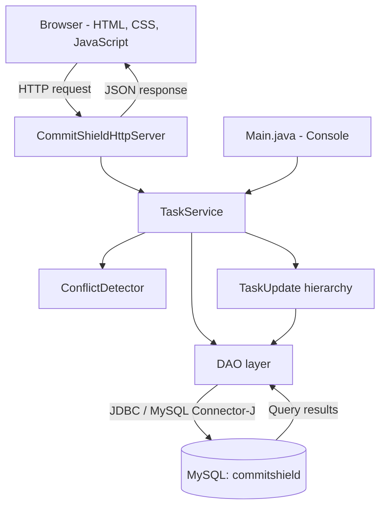
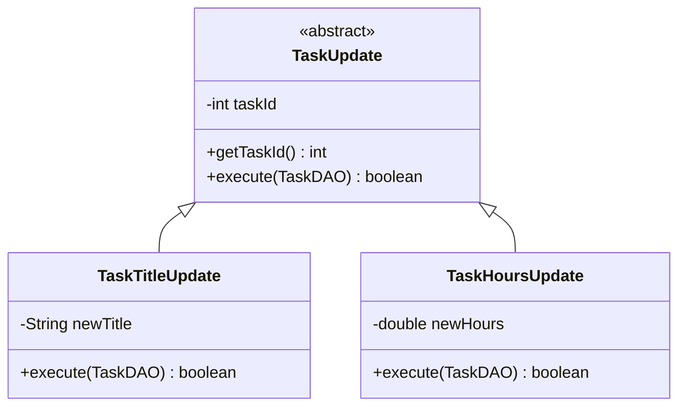
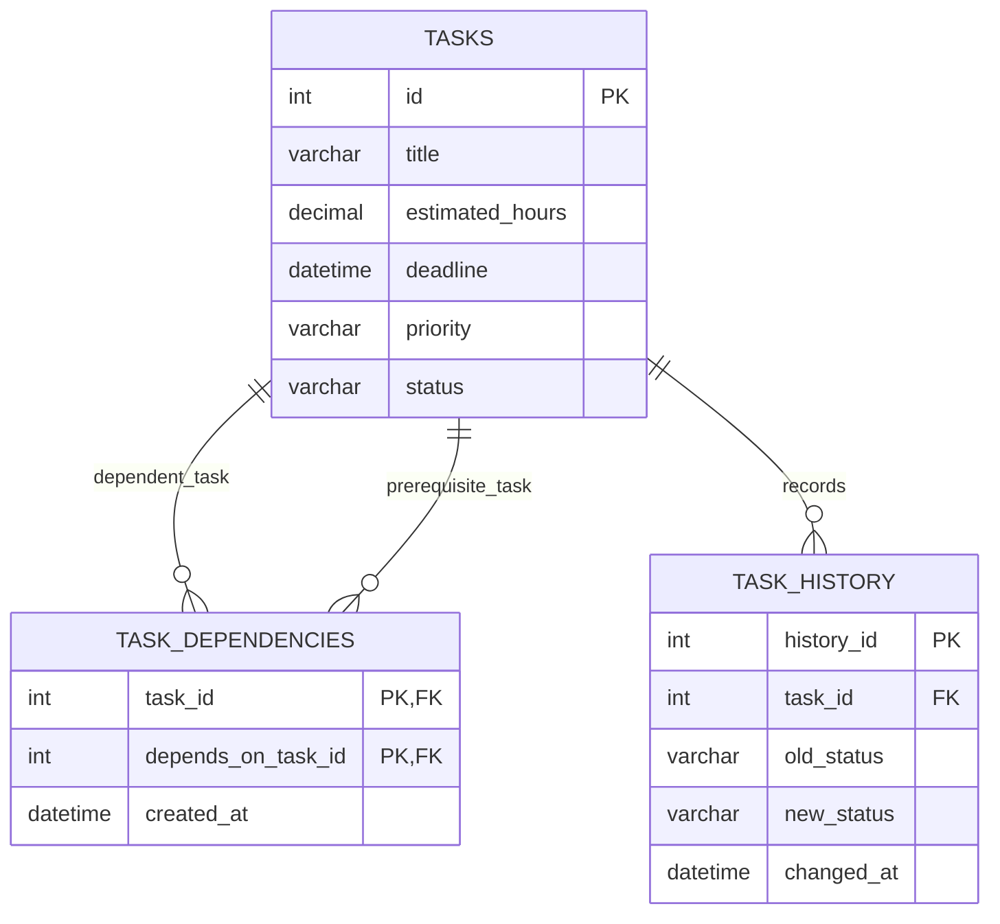

# CommitShield – Task Management & Workload Analysis


CommitShield is a Java and MySQL-based task management application developed as an integrated OOPs and DBMS academic project at Rajalakshmi Engineering College. It helps users organise tasks, manage priorities and deadlines, track prerequisites, record status changes, and compare unfinished workload with available time.

The project includes a Java console application and a browser-based dashboard powered by the JDK HTTP server. No Spring Boot or frontend framework is required.

## Features

- **Task management:** Create, view, search, edit and delete tasks.
- **Task editing:** Correct task titles and update estimated working hours.
- **Priority and deadline management:** Sort unfinished tasks by priority, then by earliest deadline.
- **Status tracking:** PENDING, IN_PROGRESS and COMPLETED.
- **Workload analysis:** Calculate unfinished hours, available hours, workload deficit and priority-wise workload.
- **Task dependencies:** Add, view and remove prerequisite relationships.
- **Task history:** Record changes to task status.
- **Web dashboard:** View task and workload information through a dark-themed interface.
- **Console interface:** Perform task operations directly from a Java terminal menu.

## Technology Stack

| Component | Technology |
|---|---|
| Programming language | Java (developed with JDK 26.0.1) |
| Backend | JDK `HttpServer` |
| Frontend | HTML, CSS, vanilla JavaScript |
| Database | MySQL |
| Database connectivity | JDBC and MySQL Connector/J |
| Data exchange | HTTP and JSON |
| Development tools | Antigravity / VS Code, MySQL Workbench |

## System Architecture



The browser communicates with Java through HTTP APIs. The service layer coordinates operations, while the DAO layer executes SQL through JDBC. The frontend does not connect directly to MySQL.

## Project Structure

```text
Integrated_Project-OOPS_and_DBMS/
├── database/
│   ├── schema.sql
│   └── commitshield_enhancements.sql
├── frontend/
│   ├── index.html
│   ├── style.css
│   └── script.js
├── lib/
│   └── mysql-connector-j.jar
└── src/com/commitshield/
    ├── Main.java
    ├── model/
    │   ├── Task.java
    │   ├── TaskPriority.java
    │   ├── TaskStatus.java
    │   ├── TaskDependency.java
    │   ├── TaskHistory.java
    │   └── WorkloadSummary.java
    ├── dao/
    │   ├── TaskDAO.java
    │   ├── TaskDependencyDAO.java
    │   └── TaskHistoryDAO.java
    ├── service/
    │   ├── TaskService.java
    │   ├── ConflictDetector.java
    │   ├── TaskUpdate.java
    │   ├── TaskTitleUpdate.java
    │   └── TaskHoursUpdate.java
    └── server/
        ├── CommitShieldHttpServer.java
        └── JsonUtil.java
```

The `out/` directory is generated during compilation.

## OOP Concepts Applied

| Concept | Implementation |
|---|---|
| Classes and objects | Task, TaskDependency, TaskHistory and other application classes |
| Encapsulation | Private fields and controlled access through getters; `TaskUpdate` stores a private final task ID |
| Abstraction | Abstract `TaskUpdate` class, service layer and DAO layer |
| Inheritance | `TaskTitleUpdate` and `TaskHoursUpdate` extend `TaskUpdate` |
| Compile-time polymorphism | `TaskService.updateTask(int, String)` and `updateTask(int, double)` |
| Runtime polymorphism | `TaskService.executeUpdate(TaskUpdate)` calls the actual subclass's overridden `execute(TaskDAO)` method |
| Interface implementation | HTTP request handlers implement the Java `HttpHandler` interface |
| Enumerations | `TaskPriority` and `TaskStatus` define permitted domain values |

### Inheritance and Polymorphism



Example of method overloading:

```java
// Correct a task title.
taskService.updateTask(1, "Java Assignment");

// Change the estimated hours of a task.
taskService.updateTask(1, 4.5);
```

Both methods create the appropriate `TaskUpdate` subclass and delegate to `executeUpdate()`. Java selects the overridden `execute()` method at runtime, and the DAO updates the corresponding database column.

## Database Design

Database name: `commitshield`

| Table | Purpose | Primary key | Foreign keys |
|---|---|---|---|
| `tasks` | Stores task details | `id` | — |
| `task_dependencies` | Stores prerequisite relationships | `task_id`, `depends_on_task_id` (composite) | Both reference `tasks.id` |
| `task_history` | Stores status transitions | `history_id` | `task_id` references `tasks.id` |

### ER Diagram



The dependency table represents a self-referencing many-to-many relationship between tasks. The history table has a one-to-many relationship with tasks. The composite primary key prevents duplicate dependency pairs. Foreign keys use cascading deletion in the supplied schema; deleting a task also removes its associated dependency and history records.

## Workload Analysis

The `ConflictDetector` class calculates the total estimated hours of tasks that are not completed.

```text
Unfinished workload = Sum of estimated hours of unfinished tasks
Workload deficit    = max(0, unfinished workload - available hours)
```

Example:

| Metric | Hours |
|---|---:|
| Unfinished workload | 20 |
| Available hours | 6 |
| Workload deficit | 14 |

The project also calculates workload by priority. Completed tasks are excluded from the unfinished workload.

## Getting Started

### 1. Prerequisites

- JDK installed and `java` and `javac` available in your terminal.
- MySQL Server running locally.
- MySQL Workbench or another SQL client.
- MySQL Connector/J JAR available at `lib/mysql-connector-j.jar`. If it is not included in your clone, obtain it from the [official MySQL Connector/J download page](https://dev.mysql.com/downloads/connector/j/) and place it at that path.
- Git, to clone the repository.

### 2. Clone the Repository

```powershell
git clone https://github.com/Mariappan-REC/Integrated_Project-OOPS_and_DBMS.git
cd Integrated_Project-OOPS_and_DBMS
```

### 3. Set Up MySQL

Open MySQL Workbench, connect to your local server and run the scripts in this order:

1. [`database/schema.sql`](database/schema.sql)
2. [`database/commitshield_enhancements.sql`](database/commitshield_enhancements.sql)

Then check the tables:

```sql
USE commitshield;
SHOW TABLES;
```

Expected tables: `tasks`, `task_dependencies` and `task_history`.

If MySQL rejects a constraint in the enhancement script, review the reported error and the actual table definitions before proceeding. Do not drop existing data to work around a schema error. Back up an existing database before altering it.

### 4. Configure Database Credentials (Windows PowerShell)

Run the following commands from the project root:

```powershell
$env:DB_URL = "jdbc:mysql://localhost:3306/commitshield"
$env:DB_USER = "root"
$securePassword = Read-Host "Enter MySQL password" -AsSecureString
$env:DB_PASSWORD = [System.Net.NetworkCredential]::new("", $securePassword).Password
```

Enter your own MySQL password at the prompt. Use a dedicated, appropriately privileged database account instead of `root` if available.

Do not commit credentials to GitHub. These environment variables apply to the current terminal session and are inherited by the Java process.

### 5. Compile the Java Application

```powershell
javac -cp ".;lib/mysql-connector-j.jar" -d out (Get-ChildItem -Path src -Recurse -Filter *.java | ForEach-Object { $_.FullName })
```

### 6. Run the Web Application

In the same PowerShell terminal:

```powershell
java -cp "out;lib/mysql-connector-j.jar" com.commitshield.server.CommitShieldHttpServer
```

Open **[http://localhost:8080/](http://localhost:8080/)** in your browser. Keep the server terminal open. Press `Ctrl+C` to stop the server.

### 7. Run the Console Application (Optional)

With the same database environment variables configured:

```powershell
java -cp "out;lib/mysql-connector-j.jar" com.commitshield.Main
```

The console includes an Edit Task option for title and estimated-hours changes.

## API Endpoints

| Method | Endpoint | Purpose |
|---|---|---|
| GET | `/api/tasks` | Retrieve all tasks |
| POST | `/api/tasks` | Create a task |
| GET | `/api/tasks/{id}` | Retrieve a task by ID |
| PUT | `/api/tasks/{id}` | Edit title and/or estimated hours |
| PUT | `/api/tasks/{id}/title` | Edit task title |
| PUT | `/api/tasks/{id}/hours` | Edit estimated hours |
| PUT | `/api/tasks/{id}/status` | Update task status |
| DELETE | `/api/tasks/{id}` | Delete a task |
| GET | `/api/tasks/unfinished` | Retrieve sorted unfinished tasks |
| GET | `/api/workload?availableHours=6` | Calculate workload summary |
| GET / POST / DELETE | `/api/dependencies` | Manage prerequisite relationships |
| GET | `/api/history` | Retrieve status history |

## Security and Limitations

- Database credentials are read from environment variables, not hardcoded in the frontend.
- JDBC prepared statements are used for parameterised database operations.
- The application is intended for local academic demonstration; authentication and production deployment security are outside its current scope.
- Status history tracks status transitions, not title or hour edits.
- Editing both title and hours through one API request currently performs separate updates; it should not be treated as an atomic transaction.
- Full regression testing of the latest editing enhancement should be completed before deployment.

## Troubleshooting

| Problem | What to check |
|---|---|
| `Address already in use: bind` | Port 8080 is occupied. Identify the process with `netstat -ano \| findstr :8080` and stop it only if it is safe to do so. |
| Database environment variables are not configured | Set `DB_URL`, `DB_USER` and `DB_PASSWORD` in the same terminal before launching Java. |
| No suitable JDBC driver | Check the Connector/J JAR path and runtime classpath. |
| Database connection failed | Check that MySQL is running and your credentials and database URL are correct. |
| Dashboard files not found | Run the server from the repository root so it can locate `frontend/`. |

## Future Enhancements

- User authentication and role-based access.
- Dependency-cycle detection and prerequisite enforcement.
- Deadline reminders and calendar integration.
- Exportable workload reports.
- Automated unit and integration testing.
- Atomic multi-field updates and improved deployment security.

## Project Team

- Mariappan G
- Hemavarshni S

**Department of Computer Science and Engineering**  
Rajalakshmi Engineering College, Thandalam  
Integrated OOPs and DBMS Project, 2026

## References

- [Java Documentation](https://docs.oracle.com/en/java/)
- [JDBC Basics](https://docs.oracle.com/javase/tutorial/jdbc/)
- [MySQL Reference Manual](https://dev.mysql.com/doc/refman/8.0/en/)
- [MySQL Connector/J Developer Guide](https://dev.mysql.com/doc/connector-j/en/)
- [MDN Web Docs](https://developer.mozilla.org/)
